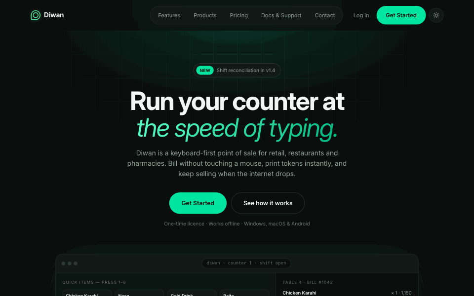
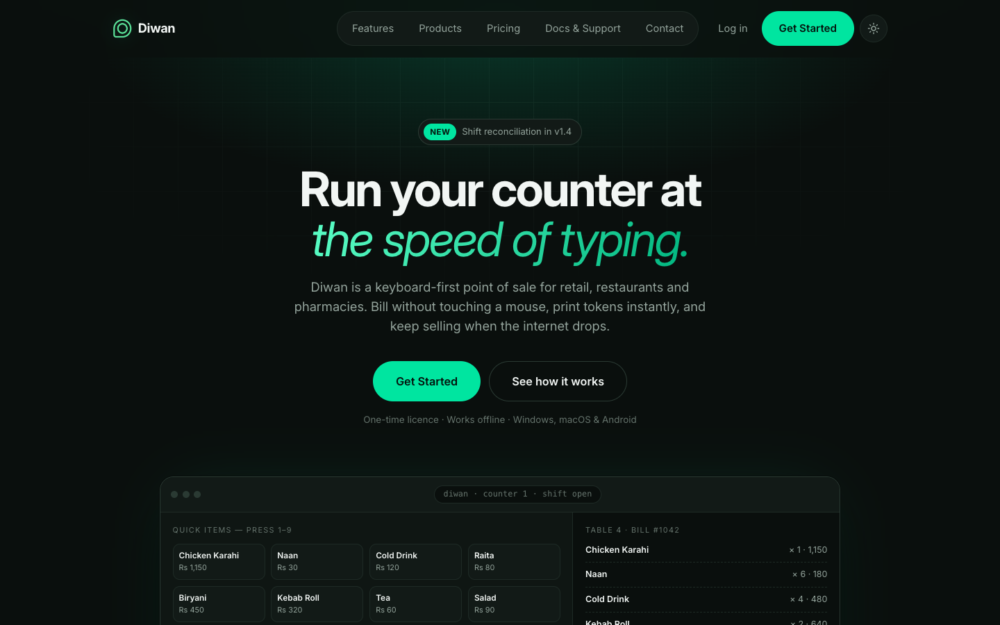
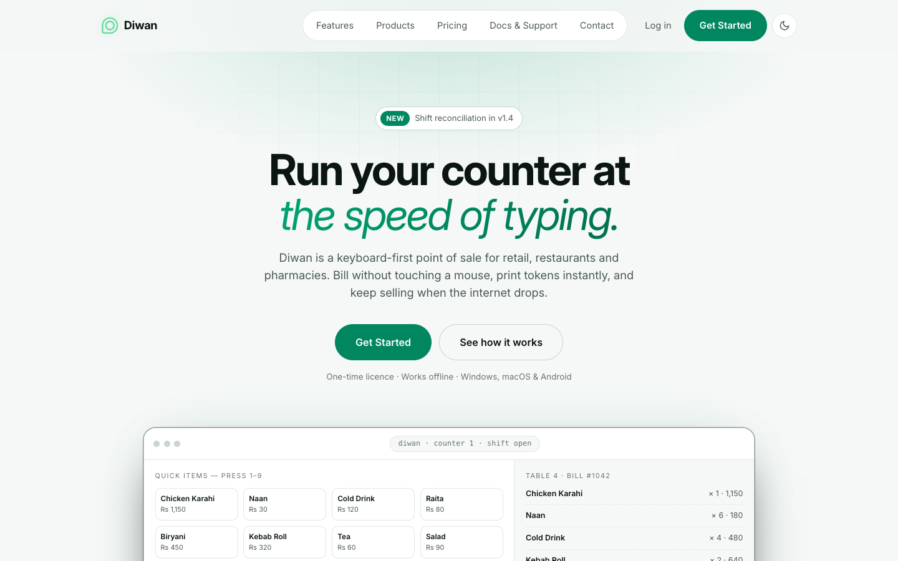
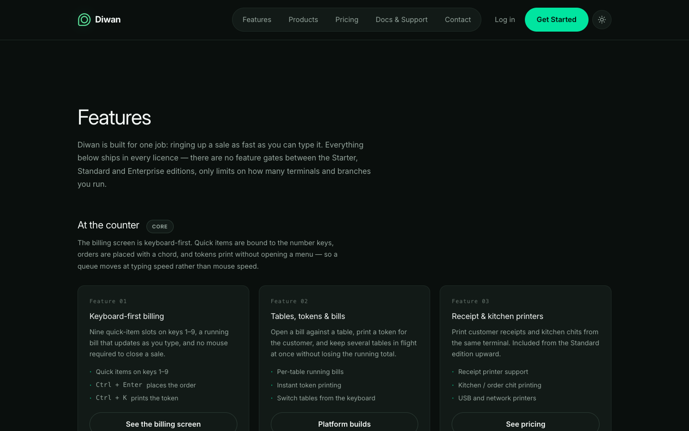
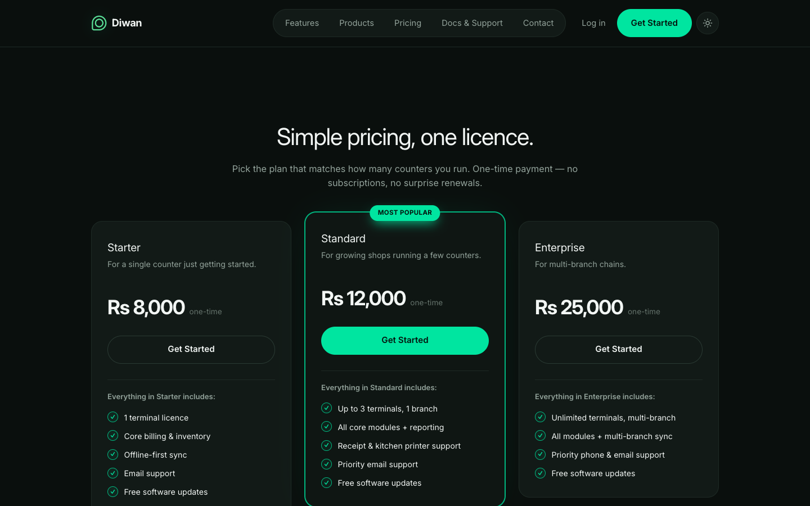
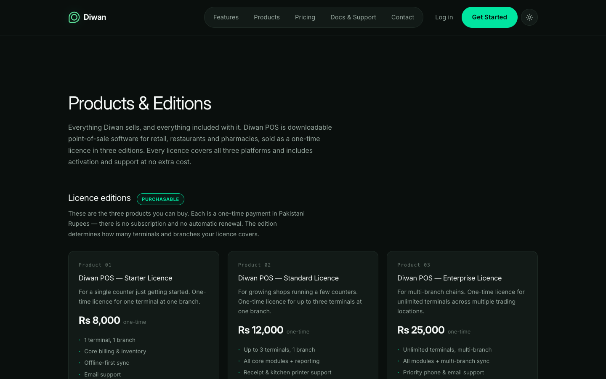
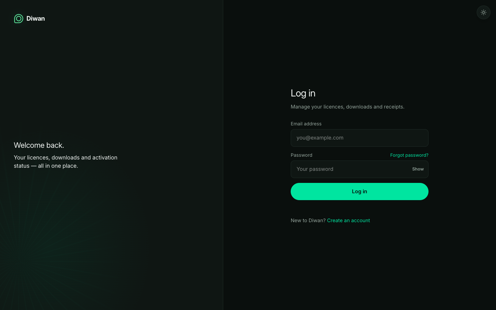
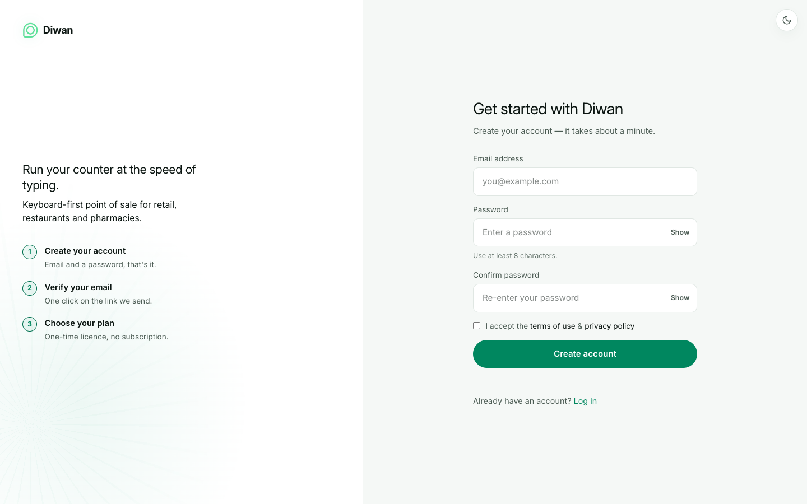
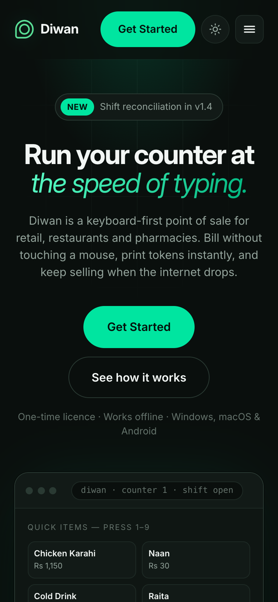
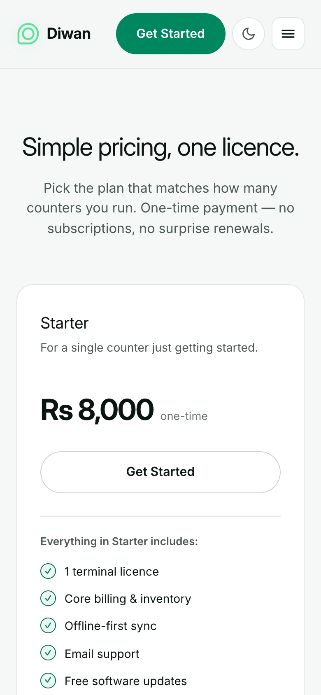

<div align="center">


# Diwan

**Run your counter at the speed of typing.**

The website, storefront and licensed-download service for **Diwan POS**, a
keyboard-first point of sale for retail, restaurants and pharmacies.

[](LICENSE)


[Features](#features) · [Screenshots](#screenshots) · [Quick start](#quick-start) ·
[Architecture](#architecture) · [Deploying](#deploying) · [License](#license)

<br>



</div>

---

## Features

**Storefront**
- Marketing site with Home, Features, Products, Pricing, Support and legal pages
- Light and dark themes that follow the system setting, with a remembered manual toggle
- Responsive layout from phone to desktop, built with plain HTML, Tailwind CSS and vanilla JS

**Accounts & licensing**
- Sign up, email verification, log in, and password reset
- Customer dashboard for licences, downloads and receipts
- One-time licences in three editions: Starter, Standard and Enterprise

**Payments & delivery**
- Checkout through JazzCash, EasyPaisa or Safepay behind one gateway interface
- Licences are issued **only** from a signature-verified payment webhook, so a forged redirect grants nothing
- Installers stream from private storage through single-use, 15-minute download tokens

**Security by design**
- Only thin entrypoints are web-reachable; all logic, config and binaries sit outside the document root
- Licence keys are stored as HMACs, so a leaked database yields no working keys
- Secrets live in GitHub Environments and are never committed or built into artifacts

## Screenshots

| Home (dark) | Home (light) |
|---|---|
|  |  |

| Features | Pricing |
|---|---|
|  |  |

| Products | Log in |
|---|---|
|  |  |

| Sign up | Mobile |
|---|---|
|  |   |

## Quick start

**Requirements:** PHP 8.1–8.3, MySQL 8.0, Bash and Perl. No Node build step is needed.

```bash
git clone <this-repo> && cd diwan-web
bash scripts/dev.sh          # → http://localhost:8000
```

The first run creates `backend/config/.env` from `.env.example` with a dev
`APP_KEY`. Fill in your local database credentials, then load the schema:

```bash
mysql -u <user> -p <database> < database/schema.sql
```

Check the backend at <http://localhost:8000/api/health.php>.

| Command | What it does |
|---|---|
| `bash scripts/dev.sh` | Build and serve locally with the production URL layout |
| `bash frontend/build.sh` | Rebuild `frontend/dist`, validate asset references, stamp asset URLs |
| `find backend -name '*.php' -exec php -l {} \;` | PHP syntax check |
| `bash scripts/smoke-test.sh <base-url>` | Post-deploy checks, including private-path protection |

## Architecture

Static marketing site + PHP payment/licensing backend + MySQL, deployed to
shared hosting over FTP by GitHub Actions.

### Project structure

```
.
├── frontend/
│   ├── src/                    plain HTML/CSS/JS — edit this
│   │   ├── index.html
│   │   ├── .htaccess           web-root rules (HTTPS, headers, dotfile deny)
│   │   ├── css/ js/ assets/
│   │   ├── build.sh            → frontend/dist  (fails loudly; no Node needed)
│   └── dist/                   BUILD OUTPUT — gitignored, never edited by hand
│
├── backend/
│   ├── public/                 → public_html/api/   THE ONLY WEB-REACHABLE PHP
│   │   ├── .htaccess
│   │   ├── index.php           returns 404 (no endpoint enumeration)
│   │   ├── health.php          deploy smoke test
│   │   ├── checkout.php        create order → gateway redirect fields
│   │   ├── payment-webhook.php verified callback → creates the licence
│   │   ├── payment-return.php  browser landing page (grants nothing)
│   │   ├── issue-download.php  licence key → single-use download token
│   │   ├── download.php        the ONLY gate in front of private-storage
│   │   └── _bootstrap.php      locates the app dir (blocked by .htaccess)
│   │
│   ├── src/                    → ~/app/src/        NOT WEB-REACHABLE
│   │   ├── bootstrap.php       autoloader, env, error handling
│   │   ├── Config/Env.php
│   │   ├── Database/Database.php
│   │   ├── Payment/            GatewayInterface + JazzCash/EasyPaisa/Safepay
│   │   ├── Order/OrderService.php
│   │   ├── License/LicenseService.php
│   │   ├── Download/DownloadService.php
│   │   └── Support/            Http, Logger
│   │
│   ├── config/                 → ~/app/config/     .env lives here (generated)
│   └── private-storage/        → ~/app/private-storage/   NEVER DEPLOYED
│       ├── releases/           installer binaries — uploaded MANUALLY, once
│       └── logs/
│
├── database/
│   ├── schema.sql              idempotent full schema + seed product
│   └── migrations/
│
├── scripts/
│   ├── dev.sh                  local server mirroring the production layout
│   ├── smoke-test.sh           post-deploy checks (runs in CI)
│   └── verify-private-storage.sh  standalone "is anything exposed?" probe
│
├── .github/workflows/
│   ├── ci.yml                  lint + build + schema check on every PR
│   └── deploy.yml              staging (auto) / production (gated) FTP deploy
│
├── .env.example                template — copy to backend/config/.env locally
└── .gitignore
```

### Why the structure is shaped this way

**One directory is web-reachable, and it contains no logic.** Everything under
`public_html/` is either a static asset or a thin entrypoint in `api/`. Each
entrypoint validates its input and hands off to a class in `~/app/src/`. A
misconfigured Apache, a missing `.htaccess`, a hosting migration that silently
drops rewrite rules — none of those can expose business logic or credentials,
because those files are not under any document root to begin with.

**Placement, not configuration, is the primary defence.** The `.htaccess` deny
rules in `backend/src/` and `backend/private-storage/` are deliberate
belt-and-braces, but they are the *second* line. The first line is that no URL
maps to those directories at all:

```
/home/youruser/                 ← FTP lands HERE
├── public_html/                ← document root for diwan.com
│   ├── index.html  css/  js/
│   └── api/                    ← the only PHP served
├── staging/                    ← document root for staging.diwan.com
│   └── api/
├── app/                        ← production application  (no document root)
│   ├── src/
│   ├── config/.env
│   └── private-storage/releases/Diwan-Setup-1.4.0.exe
└── app-staging/
```

`https://diwan.com/private-storage/…` resolves to `public_html/private-storage/`,
which does not exist → 404. There is no traversal from a URL to `~/app`, because
Apache never looks above its document root. An attacker cannot request a path
Apache will not serve.

**The app finds itself; no path is ever injected.** `api/_bootstrap.php` walks a
short list of candidate roots and picks the first that actually contains
`src/bootstrap.php` — `<root>/public_html/api/` resolves to `<root>`, and the
repo layout `backend/public/` resolves to `backend/`. `src/bootstrap.php` then
derives `DIWAN_ROOT` and `DIWAN_PRIVATE_STORAGE` from its own `__DIR__`.

Nothing is hardcoded and nothing is baked in at deploy time, so the same files
run in production, on staging, and under `scripts/dev.sh` with zero
configuration — and survive being moved or re-hosted without a redeploy.
`api/_app_root.php` remains as an optional override for a layout the candidate
list does not match; it is not generated by CI and normally does not exist.

**Build output is separate from source and gitignored.** `frontend/dist/` is the
only thing deployed. It is regenerated by CI on every run, so what is live is
always reproducible from a commit, and a stale local build can never be shipped.

### Plans, approvals and the admin panel

Plans are monthly and requested, not bought: a customer asks for BASIC,
ADVANCE or ALL-IN-ONE, an administrator approves it at `/admin/`, and only
then is a licence issued. The plan's entitlements are signed into the licence
and enforced by the POS. Setup, the workflow and the feature mapping are in
[`docs/PLANS-AND-ADMIN.md`](docs/PLANS-AND-ADMIN.md). Online checkout and free
trials are off by default (`PAYMENTS_ENABLED`, `TRIAL_SIGNUP_ENABLED`).

**Multi-counter restaurants.** All counters of one licence share one business
workspace — products, central stock, sales, staff and settings — through the
`pos-*.php` sync API, with stock reserved centrally before each online sale.
See [`docs/MULTI-COUNTER.md`](docs/MULTI-COUNTER.md) (migrations 017 and 018, and two cron jobs: `scripts/media-gc.php`, `scripts/db-backup.php`).

### Configuration and secrets

| Where | What | Committed? |
|---|---|---|
| `.env.example` | keys + explanatory comments, no values | yes |
| `backend/config/.env` | your local dev values | **no** (`.gitignore`) |
| `~/app/config/.env` on the server | real credentials | generated by CI |
| GitHub **Secrets** | DB password, gateway salts, FTP password, `APP_KEY` | n/a |
| GitHub **Variables** | non-secret per-env values: `WEB_ROOT`, `APP_ROOT`, `SITE_URL` | n/a |

Secrets never touch the repository and never touch a build artifact. The deploy
job writes `.env` on the runner immediately before uploading it, and the runner
is destroyed afterwards. `Env::load()` reads that file into a private static
array rather than `putenv()`/`$_ENV`, so a stray `phpinfo()` cannot print your
JazzCash integrity salt.

Set these per environment under **Settings → Environments → staging/production**,
so the same secret *names* carry different *values*:

Secrets: `FTP_SERVER` `FTP_USERNAME` `FTP_PASSWORD` `APP_KEY` `DB_HOST` `DB_NAME`
`DB_USER` `DB_PASS` `JAZZCASH_MERCHANT_ID` `JAZZCASH_PASSWORD`
`JAZZCASH_INTEGRITY_SALT` `EASYPAISA_STORE_ID` `EASYPAISA_HASH_KEY`
`SAFEPAY_API_KEY` `SAFEPAY_WEBHOOK_SECRET`

Variables: `WEB_ROOT` (e.g. `/public_html`) `APP_ROOT` (e.g. `/app`) `SITE_URL`
`PAYMENT_GATEWAY` `JAZZCASH_ENDPOINT` `MAIL_FROM` `FTP_PORT` `FTP_PROTOCOL` `DB_PORT`
`PAYMENTS_ENABLED` and `TRIAL_SIGNUP_ENABLED` (both default to `false`)

Generate `APP_KEY` once per environment and never rotate it casually — licence
key hashes and download tokens are HMAC'd with it, so changing it invalidates
every existing licence lookup.

### The purchase → download path

1. `POST /api/checkout.php` — price is read from the `products` table, never
   from the browser. Creates a `pending` order, returns signed gateway fields.
2. Customer pays on the gateway's own page.
3. `POST /api/payment-webhook.php` — **the only place a licence is created.**
   Signature is verified first; the raw event is recorded under a unique
   `(gateway, event_id)` index, which makes gateway retries a no-op; the order
   is marked paid and one licence issued, all in a single transaction.
4. `payment-return.php` is where the *browser* lands. It displays status and
   grants nothing — a redirect is trivially forged, so it is never trusted.
5. `POST /api/issue-download.php` — licence key (looked up by HMAC, rate limited
   to 10 attempts/IP/hour) is exchanged for a single-use token valid 15 minutes.
6. `GET /api/download.php?token=…` — token is validated and burned *before* any
   bytes are sent, then `DownloadService` streams the file from
   `~/app/private-storage/releases/` in 8 KB chunks.

Only the plaintext licence key ever leaves the system, once, by email. The
database stores `hash_hmac('sha256', key, APP_KEY)`, so a dumped database yields
no working licences.

## Deploying

Push to `staging` → deploys automatically. Push to `main` → runs a dry run you
can read, then waits for approval before touching production. Pushing a release
tag does the same: `v1.2.3` → production (must be on `main`), `v1.2.3-rc.1` →
staging. See
[docs/DEPLOYMENT.md](docs/DEPLOYMENT.md), and work through
[docs/SERVER-CHECKLIST.md](docs/SERVER-CHECKLIST.md) once before the first real
deploy.

## Shipping a new installer

Installers are **never** in git and **never** in the pipeline. Upload once by
FTP to `~/app/private-storage/releases/`, then insert a row in `releases`. Full
instructions in `backend/private-storage/README.md`.

## License

The source code in this repository is released under the [MIT License](LICENSE).
Copyright © 2026 hmzi67.

Bundled third-party code keeps its own license — notably
`backend/src/ThirdParty/sodium_compat/` (ISC). See the respective `LICENSE`
files.

## Trademarks

**Diwan**, the Diwan logo, and all related names, logos, icons, and brand
assets are trademarks of hmzi67. The MIT License applies to the source code
only; it does **not** grant permission to use the Diwan name or branding.

You may not use these trademarks to name, endorse, or promote a fork,
derivative work, product, or service, or in any way that suggests affiliation
with or approval by the owner, without prior written permission. Plain,
accurate references to the original project (e.g. "based on Diwan") are fine.

If you fork this project, remove the Diwan name and branding and use your own.

## Ownership

Diwan, including its design, content, and brand, is the property of hmzi67.
All rights not expressly granted by the MIT License are reserved.

Website content that is not source code — product copy, screenshots,
illustrations, logos, and other media under `frontend/src/assets/` — is
**not** covered by the MIT License and may not be reused without permission.

The official Diwan storefront, payment processing, licence keys, and
installers are operated solely by the owner. A licence purchased through the
official site applies only to the official Diwan software; running a copy of
this code does not create or validate genuine Diwan licences.

---

<div align="center">
<sub>© 2026 hmzi67. Diwan and the Diwan logo are trademarks of hmzi67. Code released under the <a href="LICENSE">MIT License</a>.</sub>
</div>
